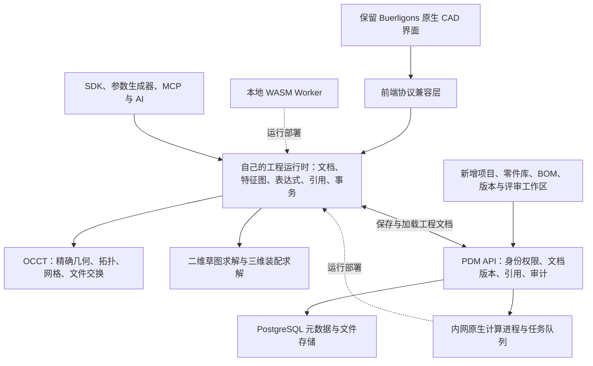

# ClassCAD 生态调研与 OCCT 在线机械设计平台规划

调研日期：2026-10-11。第一版服务场景：通用机械零件与小型设备设计。

本文将官方公开能力、当前本地原型和建议建设能力分别标注。官网能力属于官方陈述，本次没有逐项运行其商业引擎验证。本文是一份产品和技术规划，没有新增应用功能。

## 1. 产品定位

建议建设“在线参数化 CAD + 装配 + 轻量 PDM”，支持工程师设计支架、底板、轴、法兰、箱体，组合标准件与外购件，完成小型设备的装配、评审、BOM 和设计版本发布。

继续使用 Buerligons 原来的建模界面、工具条、特征树和编辑器；在其外层增加项目、零件库、版本和评审工作区。OCCT 负责几何，自己的工程运行时负责参数化、求解、引用和事务，管理服务负责项目与版本。运行不依赖 ClassCAD 的 key。

第一版验收对象建议采用一台小型定位／夹持装置：底板、支架、轴、轴承座、紧固件、滑动机构及两级装配。用实际设计任务决定能力和性能要求。

## 2. ClassCAD 的产品生态

| 产品 | 角色与公开能力 | 对本项目的启示 |
| --- | --- | --- |
| ClassCAD | 无界面的 C++ CAD 运行时，封装几何与约束求解；可通过 WASM、服务接口或独立运行时使用 | 建立统一的工程引擎 API，让界面、本地计算、服务端任务使用同一套命令 |
| Buerli.io | JavaScript／TypeScript／React SDK，连接浏览器 Worker 或服务器，并将模型交给 three.js 场景 | 保留现有前端兼容层，同时逐渐建立自己的 SDK 和文档 |
| Buerligons.io | 浏览器参数化 CAD 应用，包含草图、特征历史、装配与文件操作 | 继续复用当前原生界面，逐个接通功能并标明支持范围 |
| ClassCAD PDM | 开发中的自托管工程文档管理：版本、修订、BOM、引用、任务与生成器 | 参考其工程数据模型，建设轻量 PDM；不能把它当成已经正式发布的完整产品 |
| ClassCAD.ai | 用 API 文档与配方帮助代理编写脚本，通过 MCP／应用内助手建模，再用视图和几何指标检查结果 | AI 与人工操作使用同一工程命令，输出可编辑模型，并保存检查证据 |

来源：[ClassCAD](https://classcad.ch/)、[Buerli SDK](https://buerli.io/)、[Buerligons](https://buerligons.io/)、[PDM](https://pdm.classcad.ch/)、[ClassCAD.ai](https://classcad.ai/)。

ClassCAD 的架构还包含自己的类语言、编译字节码和运行时，以及内核、求解与文件插件。我们第一版可以用类型化命令、特征执行器与依赖图完成应用层，不必复制其语言和虚拟机。[架构说明](https://classcad.ch/docs/architecture/)

### 建模与工程能力范围

官方 API 分为 part、assembly、sketch、common、curve、solid、drawing2d 七个领域，当前首页标注 264 个方法。重点能力如下，具体覆盖应以相应 API 文档为准。

| 领域 | 官方公开能力 | 我们的优先级 |
| --- | --- | --- |
| 草图 | 几何元素、尺寸及几何约束，尺寸可关联命名表达式 | 高：通用零件建模入口 |
| 零件 | 特征历史与参数重建；拉伸、旋转、布尔、圆角、倒角、阵列、镜像及基准元素等 | 高：覆盖常用机械零件 |
| 装配 | 实例、配合、运动自由度和限位；应用列出固定、滑动、旋转、圆柱、平面、平行、球面及齿轮配合 | 高：先可靠定位，再扩展复杂运动 |
| Curve／Solid | 曲线与直接几何操作；Solid 操作位于特征内部，不独立形成完整零件历史 | 中：服务导入件和生成器 |
| Drawing2d | 投影视图、线性／角度／半径／直径尺寸、DXF 和 SVG 输出 | 中高：工程交付需要，但要单独建设编辑界面 |
| 文件 | 专有 OFB 保存历史；STEP 交换几何；STL 用于网格；SCG 用于结构和图形显示 | 高：自己的原生格式保存设计意图，STEP 负责交换 |
| 协作与自动化 | 共享会话、程序调用、模型生成及检查 | 分阶段：先版本和评审，再多人编辑、AI |

来源：[零件 API](https://classcad.ch/docs/API/part/)、[草图 API](https://classcad.ch/docs/API/sketch/)、[装配 API](https://classcad.ch/docs/API/assembly/)、[二维图 API](https://classcad.ch/docs/API/drawing2d/)、[文件与会话能力](https://classcad.ch/)。

### 要区分的成熟度

- ClassCAD 首页将 Loft、Sweep、Pipe、Helix、Shell 标为测试中、即将提供；不能据此推断已有完整高级曲面产品。
- 引擎有 Drawing2d API，但 Buerligons 官网明确列出应用尚不支持二维工程图、扫掠、SAT 和 IGES。界面与引擎的能力范围不同。[应用边界](https://buerligons.io/)
- ClassCAD PDM 明确未正式发布。官网列出的现有开发能力包括文档、版本、修订、BOM 和编辑预留；自有 OIDC 登录、项目权限、安装包、S3 存储、生成器沙箱等列为发布前待完成项。[PDM 状态](https://pdm.classcad.ch/)
- AI 工具的实时共享会话与 PDM 的长期版本存储是两种服务；关闭共享会话不等于生成一份正式工程版本。[AI 会话](https://classcad.ai/)

## 3. 当前 OCCT 原型的真实起点

依据本项目 `OCCT-PILOT.md` 的实现范围和此前验证记录：

| 当前已接通 | 当前限制 |
| --- | --- |
| 原来的 App、工具条、特征树、草图／拉伸／装配编辑器 | 可见按钮不代表对应内核能力已迁移 |
| 本地 OCCT WASM，真实 BRep 构建、校验和显示 | 当前只支持单个 XY 轴对齐矩形、宽高尺寸和正向实体拉伸 |
| 零件模板导入、重复实例、共享模板编辑 | JSON 内嵌模板，单层装配；最多 16 个模板、16 个实例、64 个约束 |
| 八种基本配合、限位、Values、拖动、事务与撤销 | 自建刚体求解器；配合引用只覆盖原点与矩形体六面，不是任意几何的成熟装配系统 |
| 零件和装配 JSON 保存／打开 | 尚无独立文档库、跨文件引用、版本服务、BOM 或团队权限 |

尚未接通通用草图求解、多草图、布尔、旋转、圆角、子装配、齿轮配合、STEP 交换、工程图与 PDM。

当前 `opencascade.js@1.1.1` 自带的是 OCCT 7.4.0p1。后续需要验证生产使用的内核版本和绑定范围，建立可以复现的 WASM／原生构建，不宜只根据最新 OCCT 文档假定现有安装包都有相应接口。原型细节与验证记录见 [OCCT-PILOT.md](./OCCT-PILOT.md)。

## 4. 建议的完整技术结构

以上为建议架构，不是已经完成的系统。

### 核心职责

1. **OCCT 几何层**：实体、曲线曲面、几何运算、网格与交换格式。
2. **工程运行时**：特征依赖、表达式、尺寸单位、稳定引用、求解、失败回滚及撤销。几何计算失败时保留上一个有效状态，并定位失败特征。
3. **PDM 服务**：文档身份、版本、装配引用、发布状态、权限和审计。它记录设计状态，避免把每一份导出文件都当成独立零件。
4. **前端和 SDK**：展示状态、提交工程命令。人工、脚本和 AI 使用同一入口。

OCCT 的 OCAF 可提供文档、事务、属性与拓扑命名基础，但我们仍须实现特征语义、驱动器及算法产生的拓扑变化记录；它不会自动解决所有面／边引用问题。[OCAF](https://occt3d.com/dev/doc/overview/html/occt_user_guides__ocaf.html)

XDE／XCAF 可承载装配层级、共享形状、实例位置和相关属性，是 STEP 装配交换的合适基础。它本身不提供我们的配合求解、版本管理和发布流程。[XDE](https://occt3d.com/dev/doc/overview/html/occt_user_guides__xde.html)

### 从现在就确定的数据规则

- 文档、特征、草图实体、实例和配合使用持久 ID；显示名称及当前拓扑遍历序号不能充当永久身份。
- 建立自己的规范工程文档，保存单位、参数、表达式、特征、引用、约束、格式版本及内核版本。现有 SCG／数字 ID 保留为界面协议映射。
- 原生工程文档保存设计意图；BRep 与网格可作为校验后的缓存。STEP 导入件可以继续装配或加工，但不能承诺恢复原 CAD 软件的草图与特征历史。
- 草稿可编辑；工程版本不可变；修订是被批准发布的版本。导出件、缩略图和 BOM 必须绑定源版本。
- 装配实例引用 `documentId + versionId`，另有实例位置和配合。冻结装配时锁定整个引用链，包括子装配里的零件。
- 浏览器与原生计算使用同一工程命令和兼容的版本规则；多人编辑采用明确的权威会话及命令顺序。
- 离线包包含所需依赖。回到内网时先比对基准版本，出现冲突由用户选择如何保留，不能静默覆盖同事修改。

## 5. 对工程师最有价值的管理能力

推荐第一版管理对象：项目、工程文档、零件／装配、标准件、外购件、版本、修订和派生交付物。

| 功能 | 工程使用方式 |
| --- | --- |
| 零件库 | 搜索编号、名称、材料和规格；复用已有设计或复制为新文档 |
| 标准件／外购件库 | 先提供少量验证过的螺栓、螺母、轴承等，保存规格、来源与采购字段 |
| 装配 BOM | 结构 BOM 与展开零件表，按文档和版本归并数量，区分自制件与采购件 |
| 反查使用位置 | 修改轴承座前，看到哪些装配和发布版本在引用它 |
| 更新引用 | 提示零件有新版本，由工程师选择升级并重新检查装配 |
| 评审和发布 | 评审意见绑定版本；发布前检查模型、约束、BOM 和交付物 |
| 权限与并发 | 项目查看／编辑／发布权限；编辑预留与基于版本的保存冲突检查 |
| 后台任务 | 缩略图、质量属性、STEP、图纸和 BOM 生成，保留结果与失败原因 |

这里采用 ClassCAD PDM 的“工程文档—草稿—版本—修订—引用”思路，再按我们的场景实现。[文档模型](https://pdm.classcad.ch/docs/concepts/documents/)、[草稿与版本](https://pdm.classcad.ch/docs/concepts/drafts-and-versions/)、[装配引用](https://pdm.classcad.ch/docs/concepts/assemblies/)

例如：支架 `BRK-001/v1` 已进入装配 `ASM-001/v3`，并随设备修订 A 发布。支架后来产生 v2，旧设备仍引用 v1；工程师检查受影响装配、主动更新、重新求解和评审后，才发布设备修订 B。这一规则应在引入外部零件引用时建立。

## 6. 实施顺序和验收门槛

以下是建议路线，按验收推进；工期需结合人员、求解器选型和几何样本测算。

| 阶段 | 主要工作 | 验收门槛 |
| --- | --- | --- |
| 0：工程基础 | 规范文档、持久 ID、特征依赖、引用策略、事务、格式迁移；确定内核及绑定构建；评估通用二维求解器 | 当前矩形与装配文件可迁移；尺寸重建、保存重开、撤销及错误回滚保持一致 |
| 1：常用机械零件 | 直线／圆／圆弧与约束、多草图和基准面、拉伸加料／切除、旋转、布尔、孔、圆角／倒角、阵列／镜像；质量属性、STEP | 用原生界面完成带孔支架、底板和阶梯轴；修改前序尺寸后后续引用保持正确，无法解析时明确报错 |
| 2：真实设备装配 | STEP 外购件、通用面／轴配合、子装配、实例复用、自由度与冲突诊断、标准件库、间隙／干涉检查 | 完成两级夹持装置；零件更新、配合重求解、重复实例和装配重开可靠；限制与不支持情况明确 |
| 3：轻量 PDM | 项目权限、文档库、草稿／版本／修订、冻结引用、BOM、反查引用、评审、预留与保存冲突检查、备份恢复 | 两位工程师协作修改，旧发布版不被新零件污染；BOM 与交付物能追溯到确定版本 |
| 4：交付和自动化 | 工程图视图与尺寸、必要的技术说明／公差表达、图框与明细表、PDF／DXF；参数化模板、批处理、SDK、MCP 与 AI | 一键生成与指定发布版一致的图纸、STEP 和 BOM；脚本结果仍能在原生界面编辑，检查失败不发布 |

PDM 的编号、版本和引用结构应从阶段 0 开始设计，并可与阶段 1 建模功能交错建设；完整团队界面放在阶段 3。普通支架和轴件的稳定建模优先于高级曲面；齿轮联动、复杂机构动力学、CAE、CAM 和大装配优化另行评估。

### 优先解决的技术难点

1. **通用草图求解**：圆和圆弧、约束冗余／冲突、欠约束反馈，不能继续用矩形宽高逻辑覆盖全部草图。
2. **稳定拓扑引用**：在开孔、倒角、布尔和阵列之后追踪正确面／边；不能仅按位置猜测或靠第几个面匹配。
3. **装配求解的可靠性**：任意几何配合、闭环、奇异姿态、自由度及残差诊断；当前八种配合原型不能直接当成工业级求解器。
4. **跨文档版本引用**：共享定义与实例分离，发布版引用链不可变，更新必须可审查和回退。
5. **计算与管理一致性**：长任务隔离、超时与恢复，服务端生成交付物时记录确切源版本和内核环境。

服务端可以参考 ClassCAD 对交互会话与重导入任务分开的调度方式，第一版先用简单的进程隔离与任务队列，无需一开始复制完整自动扩缩容系统。[调度设计](https://pdm.classcad.ch/docs/concepts/engines/)

## 7. 推荐的第一条完整业务流程

创建夹持装置项目 → 设计带孔底板、支架及阶梯轴 → 插入轴承和螺栓 → 建立子装配与配合 → 检查运动限位、干涉和质量 → 生成 BOM → 同事评审 → 冻结版本并发布 → 导出 STEP 与工程图。

随后修改一个支架尺寸：保存新零件版本 → 查看受影响装配 → 选择更新 → 重新检查 → 发布新的设备修订。这个流程走通，才能说明平台同时具备设计和工程管理能力。

下一步最合适的实现范围是阶段 0 加阶段 1 的一个纵向样例：仍用原生界面，完成“带孔支架的草图约束、拉伸、切孔、尺寸修改、引用重建及 STEP 交换”。在此过程中把数据模型升级到可支持文档版本和后续子装配的结构。

## 8. 官方资料入口

- [ClassCAD 产品与能力](https://classcad.ch/)
- [ClassCAD 运行时架构](https://classcad.ch/docs/architecture/)
- [Buerli SDK](https://buerli.io/)
- [Buerligons 应用](https://buerligons.io/)
- [ClassCAD PDM 状态](https://pdm.classcad.ch/)
- [PDM 文档](https://pdm.classcad.ch/docs/)
- [PDM 开发结构](https://pdm.classcad.ch/docs/development/)
- [ClassCAD.ai](https://classcad.ai/)
- [官方 AI 工具代码仓库](https://github.com/awv-informatik/classcad-ai)
- [OCCT OCAF](https://occt3d.com/dev/doc/overview/html/occt_user_guides__ocaf.html)
- [OCCT XDE](https://occt3d.com/dev/doc/overview/html/occt_user_guides__xde.html)

AI 工具仓库可参考 API 文档检索、脚本执行和结果检查的组织方式；它并不意味着 ClassCAD 商业引擎或 SMLib 内核开源。我们建设的是独立 OCCT 后端及其工程应用层，复用前端时保留适用的第三方许可。
